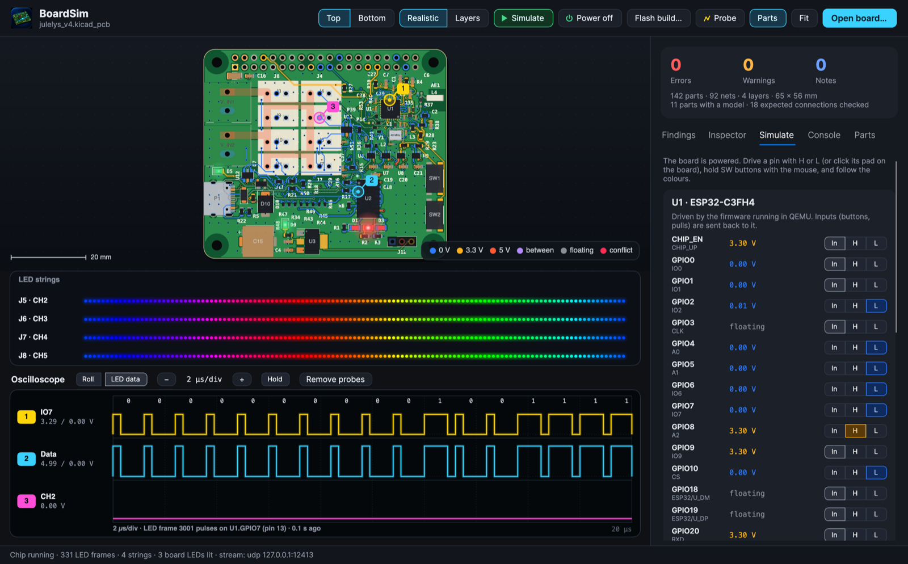
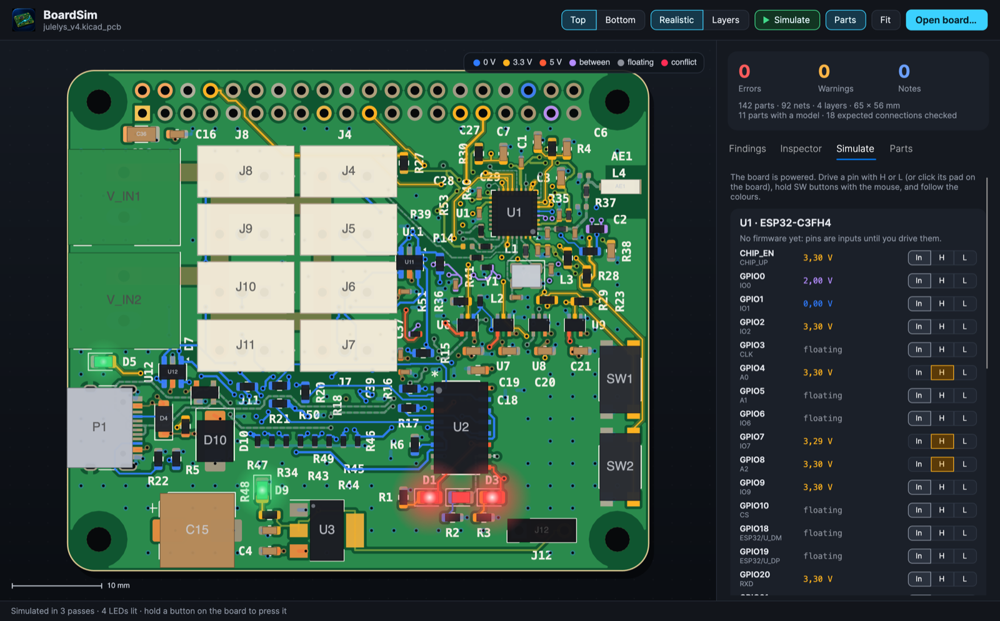
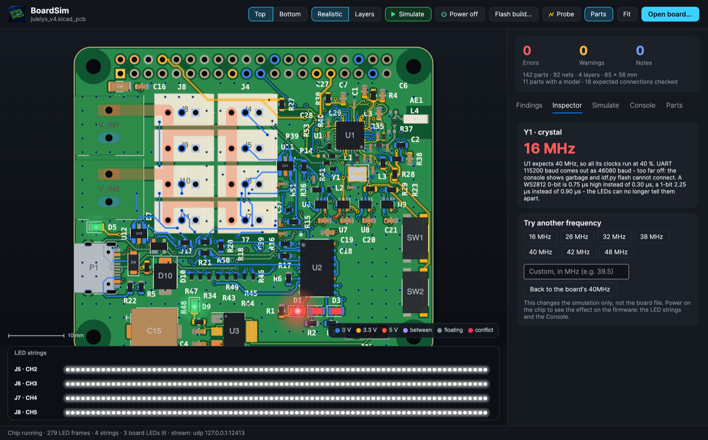

<p align="center">
  
</p>

<h1 align="center">BoardSim</h1>

<p align="center">
  <b>Open a KiCad board. See it as it will be made. Find the mistakes before you order it.<br>
  Then power it on, flash real firmware into it, and watch it run.</b>
</p>

<p align="center">
  <a href="https://github.com/egernet/BoardSim/releases"><b>Download for Windows, Linux and Mac</b></a> ·
  <a href="#quick-start">Quick start</a> ·
  <a href="#flash-it-like-a-real-board">Flash with idf.py</a> ·
  <a href="#how-it-works">How it works</a>
</p>



<p align="center"><i>The Julelys v4 board running its real firmware: the rainbow on four LED strings is decoded
from the chip's RMT output, and the oscilloscope shows the same bits at 3.3 V on GPIO7, 5 V after the level shifter
and 4.8 V on the connector.</i></p>

---

## What it does

| | |
|---|---|
| 🔍 **Checks every connection** | Unrouted nets, 5 V on a 3.3 V pin, a 3.3 V output into a 5 V input, strapping pins that boot the wrong way, floating inputs, missing pull-ups, decoupling, crystals - and the pins your firmware expects. |
| ⚡ **Simulates the circuit** | A DC solver computes the real voltage on every net: dividers, pull-ups, LEDs with their forward voltage, a mux routing a signal. Copper is coloured by voltage, LEDs glow by their current. |
| 🧠 **Runs real firmware** | The board's ESP32-C3 runs in an emulator (a QEMU fork). Its pins drive the simulation; buttons on the board reach its inputs. |
| 🔌 **Has a USB port** | `idf.py -p rfc2217://localhost:4141 flash monitor` - esptool resets the emulated chip into download mode and flashes it, like a board on your desk. |
| 📈 **Has an oscilloscope** | Clip up to four probes on any net: GPIO signals from the firmware at the voltage that net really has, LED data with decoded bits, crystals. Frequency, duty cycle and levels are measured, AUTO picks the time base, and Normal/Single triggers capture an edge and hold it. |
| 💡 **Shows LED strings** | WS2812 data is decoded and followed through buffers and multiplexers to the connector it actually reaches. |
| 📶 **Has Wi-Fi** | Add one component and the firmware's own Wi-Fi code connects in BoardSim, with real internet through your computer. |
| 🥧 **Talks to a Raspberry Pi** | The pins are open on the network: `nc`, a Python library in the style of `RPi.GPIO`, or a bridge to a real Pi's pins. |
| 📡 **Estimates noise and emission** | Which nets switch and how fast (edge times from the real part models), the plane under every millimetre of track, loop areas, reference changes, TVS distances, crosstalk - and a radiated-emission spectrum against the CISPR 32 class B limit. |
| 🧩 **Uses your real parts** | Part models from a `boardsim-parts` folder, and every footprint's 3D model found the way KiCad finds it - also when an old board points at `${KICAD6_3DMODEL_DIR}` or a file in someone's Downloads. Press **3D** to see the board with them, and the realistic view shows KiCad's own render of each side (KiCad 8+; without it parts are drawn as outlines and boxes). |
| 🕰️ **Lets you break things** | Click the crystal and give it another frequency: the UART turns to garbage, the LED timing falls apart - exactly as on hardware. |

## Quick start

Download the archive for your computer from the [releases page](https://github.com/egernet/BoardSim/releases).
Each one carries its own .NET runtime, the emulator and an example board with firmware - nothing
else to install.

### Windows (x64)

1. Unzip **BoardSim-…-windows-x64.zip** anywhere, e.g. `C:\Tools\BoardSim`.
2. Start **BoardSim.exe**. Windows SmartScreen may warn about an unknown publisher the first time:
   *More info → Run anyway*.
3. Press **Try the Julelys example**.

### Linux (x64 or arm64, e.g. a Raspberry Pi 4/5)

```bash
tar -xzf BoardSim-*-linux-x64.tar.gz      # or linux-arm64
cd BoardSim
./BoardSim                                # needs a desktop (X11 or XWayland)
./install-desktop-entry.sh                # optional: add it to the application menu
```

Built on Ubuntu 22.04: any Linux with glibc 2.35 or newer (Ubuntu 22.04+, Debian 12+, Fedora 36+,
Raspberry Pi OS Bookworm).

### Mac (Apple Silicon)

1. Unzip **BoardSim-…-macos-arm64.zip** and move **BoardSim.app** to *Applications*.
2. The app is not notarised by Apple, so macOS stops it the first time. Run this once in Terminal:
   ```bash
   xattr -dr com.apple.quarantine /Applications/BoardSim.app
   ```
   (or open it, then *System Settings → Privacy & Security → Open Anyway*).
3. Open BoardSim and press **Try the Julelys example**.

Within a few seconds the chip boots, gets an IP address on its emulated network and plays a rainbow
on its four LED strings. The command-line tool is `boardsim-cli` next to the app
(`boardsim-cli chip board.kicad_pcb` runs a board headless).

### Things to try in the example

- **Findings** - v4 is clean. Open `tests/fixtures/julelys_v31.kicad_pcb` (the previous revision) and
  click the red finding: GPIO8 drives an LED to ground, which kept the chip out of download mode.
- **Probe** → click GPIO4 and GPIO7 on U1, pin 2 of J5 and a pin of the crystal Y1, then **AUTO**
  on a channel: 27 Hz on the mux select line, 833 kHz LED data (3.3 V at the chip, 4.8 V on the
  connector) and 40 MHz on the crystal. Click a channel's number to trigger on it, pick the edge,
  and press **Single**: the scope waits for the next edge, captures it and holds.
- Hold **SW1** (BOOT) with the mouse and watch IO9 go to 0 V.
- Click the **crystal Y1** and pick 26 or 16 MHz, then look at the LED strings and the **Console** tab.
- **Bottom** shows the other side; **Layers** shows the copper layers in colour.

## Flash it like a real board

Power on the chip (or open the example). The **Console** tab shows its USB port:

```bash
idf.py -p rfc2217://localhost:4141 flash monitor
```

- The port speaks RFC 2217 (a serial port over TCP). esptool and `idf.py` support it out of the box,
  on macOS, Linux and Windows, with no driver.
- It carries DTR and RTS, and BoardSim emulates the board's two-transistor auto-reset circuit, so
  esptool's usual reset sequence puts the chip into download mode and `--after hard_reset` boots the
  new firmware.
- The flash is kept per board in `~/.boardsim/flash/`. **Power on** boots what you flashed last time.
- **Flash build…** writes an ESP-IDF build folder straight into flash, without esptool.
- Headless: `boardsim chip board.kicad_pcb` powers the chip and serves the same port.

### Wi-Fi

The ESP32's radio cannot be emulated, so BoardSim emulates the Wi-Fi *API* instead. Add the
[`boardsim_wifi`](firmware/components/boardsim_wifi) component to your project and rebuild once:

```bash
idf.py -D EXTRA_COMPONENT_DIRS=/path/to/BoardSim/firmware/components build
```

The same binary runs on the real board (every call goes to ESP-IDF's own Wi-Fi) and in BoardSim,
where `esp_wifi_connect()` succeeds, `IP_EVENT_STA_GOT_IP` arrives and the firmware has the
network and the internet through your computer - Espressif's `http_request` example fetches
example.com unchanged. Inside, the chip is 10.0.2.15 and your computer 10.0.2.2.

UDP port 2412 in the chip is forwarded from `127.0.0.1:12412` (or the next free port), so the
Julelys manager can stream to the simulated tree:

```bash
JulelysManager --mode stream --host 127.0.0.1 --port 12412 --matrix-width 4 --matrix-height 125
```

## Talk to it from a Raspberry Pi

The board's pins are open over the network (port **4142**), so a Raspberry Pi - or any script - can
play the device plugged into it. On a HAT like Julelys v4 the Pi's pins *are* the header, so
`GPIO17` means J1 pin 11, and what the Pi does travels through the simulated circuit to the
firmware and back.

```text
$ nc localhost 4142
boardsim gpio 1 - board julelys_v4 - type 'help'
watch J1                     → reports every change on the Pi header: change J1.24 high 3.30
set GPIO5 low                → holds the ESP32 in reset through R28 (CHIP_EN 0.31 V)
set GPIO5 input              → releases it: the firmware boots again
get U1.GPIO0                 → U1.4 high 2.82
```

From Python, as if the code ran on the Pi ([`clients/python`](clients/python), no dependencies):

```python
import boardsim_gpio as GPIO        # instead of: import RPi.GPIO as GPIO
GPIO.connect("192.168.1.20")        # the Mac running BoardSim
GPIO.setmode(GPIO.BCM)
GPIO.setup(17, GPIO.OUT)
GPIO.output(17, GPIO.HIGH)
GPIO.add_event_detect(9, GPIO.BOTH, callback=lambda ch: print("MISO", GPIO.input(ch)))
```

And with a real Pi's pins: a button on the Pi presses into the simulation, an LED on the Pi follows
the firmware:

```bash
python3 pi_bridge.py 192.168.1.20 --in 17 --out 27
```

Turn on **Allow from network** in the Console tab (or `boardsim chip board.kicad_pcb --lan`) for a
Pi on your LAN to reach it - home networks only, there is no password.

CHIP_EN and GPIO9 are wired through the simulation: the **RESET** and **BOOT** buttons on the board,
or a Pi holding EN low with GPIO9 low, reset the emulated chip into download mode - just like the
v4 board lets a Pi flash its ESP32.

## Find the mistakes


Every rule is checked on the real geometry and netlist. On the previous Julelys revision (v3.1)
BoardSim finds exactly what was fixed in v4: the LED on the GPIO8 strapping pin, the multiplexer
outputs that float on the connectors, 100 nF on GPIO9 and the missing pull-up on GPIO2.

**Expected connections.** Put a `<board>.boardsim.json` next to the board to say what the firmware
expects; BoardSim traces each path through resistors and buffers:

```jsonc
{
  "ledOrder": "RGB",
  "connections": [
    { "from": "U1.GPIO7", "to": "U2.Z",  "why": "LED data from the RMT, through level shifter U6" },
    { "from": "U1.GPIO4", "to": "U2.S0", "why": "mux select bit 0" },
    { "from": "U2.Y0",    "to": "J4.2",  "why": "channel 0 = CH1" }
  ]
}
```

**Part models.** What BoardSim knows about a part - power range, absolute maximum, input
threshold, strapping level, required pulls, behaviour in the simulation - is a small JSON file.
Built-in models are in [`src/BoardSim.Core/Parts/Models`](src/BoardSim.Core/Parts/Models); put your
own `*.part.json` in a `boardsim-parts` folder next to the board. Parts without a model still get
the generic checks.

## Simulate without firmware



Press **Simulate** and drive the chip's pins yourself with **In / H / L**, or click a pad.
Blue is 0 V, amber 3.3 V, red 5 V, purple in between, grey floating, flashing red a conflict
(two outputs fighting).

<table>
<tr>
<td></td>
<td></td>
</tr>
<tr>
<td align="center"><i>A 16 MHz crystal on a 40 MHz chip: every LED bit reads as a 1.</i></td>
<td align="center"><i>Layer view: each copper layer in its own colour.</i></td>
</tr>
</table>

## Noise and emission

The **EMC** tab (and `boardsim-cli emc board.kicad_pcb`) estimates how noisy the layout is:

- **Signals**: USB, crystals and UART are found by themselves; firmware signals go in the board's
  `.boardsim.json` (`"signals": [{ "pin": "U1.GPIO7", "hz": 800000, "why": "LED data" }]`), and
  cable lengths per connector under `"cables"`. Each signal is followed through series resistors,
  buffers (a new edge) and analog muxes (one output at a time).
- **Edges** come from the driver's part model (`riseNs`, `driveOhms`, with the datasheet source);
  parts without one are marked generic.
- **Return paths** from the stackup in the board file and the filled zones: the plane under every
  half millimetre of track, stretches with no plane, signals over a supply plane, and vias that
  change the reference without a capacitor nearby.
- **Emission**: differential mode from each loop and common mode from cables, at 3 m, against
  CISPR 32 class B. **Crosstalk**: backward coupling between parallel tracks.

These are engineering estimates, typically within 10-20 dB of a chamber measurement: good for
comparing two layouts and finding the worst nets, not for certification.

## How it works

```
 KiCad .kicad_pcb ──► loader ──► board model ──► rules ──► findings
                                     │
                                     ▼
                               circuit (nets, parts, models)
                                     │
                       ┌─────────────┴──────────────┐
                       ▼                            ▼
                DC simulation  ◄── pin levels ── QEMU fork (ESP32-C3)
                (voltages, LEDs)  ── inputs ──►   GPIO · RMT · ADC · UART
                       │                            │        ▲
                       ▼                            ▼        │ RFC 2217 + DTR/RTS
             board view · scope · LED strings     esptool / idf.py
```

- **BoardSim.Core** - KiCad loader (KiCad 6-10), connectivity, rules, part models, the DC simulator
  and the emulation bridge. No UI.
- **BoardSim.App** - the Avalonia desktop app (Windows, macOS, Linux).
- Releases: tag `vX.Y.Z` and `.github/workflows/release.yml` packages every platform with the
  emulator from qemu-boardsim's release (`scripts/package.sh`).
- **BoardSim.Cli** - `boardsim-cli check | parts | pins | chip | gpio | emc`.
- **clients/python** - `boardsim_gpio.py` (RPi.GPIO style) and `pi_bridge.py` (real Pi pins).
- **[qemu-boardsim](https://github.com/egernet/qemu-boardsim)** - Espressif's QEMU with ESP32-C3
  GPIO, RMT and SAR ADC emulation, a pin bridge to BoardSim and reset control.

## Build from source

```bash
git clone https://github.com/egernet/BoardSim
cd BoardSim
dotnet run --project src/BoardSim.App          # .NET 8 SDK or newer
dotnet test
```

Firmware emulation needs the QEMU fork. Build it from
[egernet/qemu-boardsim](https://github.com/egernet/qemu-boardsim) (branch `boardsim`, target
`riscv32-softmmu`) and point `BOARDSIM_QEMU` at `qemu-system-riscv32`, or put it in
`~/.boardsim/qemu/bin/`. `scripts/package-macos.sh` builds the self-contained Mac app.

## Roadmap

- More part models, and more chips than the ESP32-C3.

## License

MIT for BoardSim. The emulator bundled in the Mac app is
[qemu-boardsim](https://github.com/egernet/qemu-boardsim), GPL v2 like QEMU; its source is in
that repository. The test and example boards are Julelys v4 and v3.1 from
[egernet/julelys_pcb_v2](https://github.com/egernet/julelys_pcb_v2); the example firmware is built
from [egernet/julelys_esp32](https://github.com/egernet/julelys_esp32).
