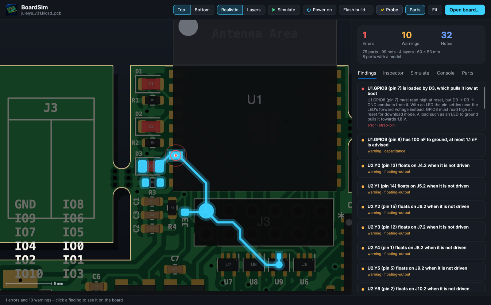
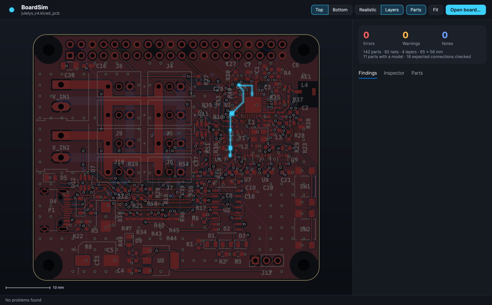

<p align="center">
  
</p>

<h1 align="center">BoardSim</h1>

<p align="center">
  <b>Open a KiCad board. See it as it will be made. Find the mistakes before you order it.<br>
  Then power it on, flash real firmware into it, and watch it run.</b>
</p>

<p align="center">
  <a href="https://github.com/egernet/BoardSim/releases"><b>Download for Mac</b></a> ·
  <a href="#quick-start">Quick start</a> ·
  <a href="#flash-it-like-a-real-board">Flash with idf.py</a> ·
  <a href="#how-it-works">How it works</a>
</p>


<p align="center"><i>The Julelys v4 board running its real firmware: the rainbow on four LED strings is decoded
from the chip's RMT output, and the oscilloscope shows the same bits at 3.3 V on GPIO7, 5 V after the level shifter
and 4.8 V on the connector.</i></p>

---

## What it does

| | |
|---|---|
| 🔍 **Checks every connection** | Unrouted nets, 5 V on a 3.3 V pin, a 3.3 V output into a 5 V input, strapping pins that boot the wrong way, floating inputs, missing pull-ups, decoupling, crystals - and the pins your firmware expects. |
| ⚡ **Simulates the circuit** | A DC solver computes the real voltage on every net: dividers, pull-ups, LEDs with their forward voltage, a mux routing a signal. Copper is coloured by voltage, LEDs glow by their current. |
| 🧠 **Runs real firmware** | The board's ESP32-C3 runs in an emulator (a QEMU fork). Its pins drive the simulation; buttons on the board reach its inputs. |
| 🔌 **Has a USB port** | `idf.py -p rfc2217://localhost:4141 flash monitor` - esptool resets the emulated chip into download mode and flashes it, like a board on your desk. |
| 📈 **Has an oscilloscope** | Clip up to four probes on any net and see the signal: seconds in roll mode, microseconds on LED data, with decoded bits. |
| 💡 **Shows LED strings** | WS2812 data is decoded and followed through buffers and multiplexers to the connector it actually reaches. |
| 🕰️ **Lets you break things** | Click the crystal and give it another frequency: the UART turns to garbage, the LED timing falls apart - exactly as on hardware. |

## Quick start

### On a Mac (Apple Silicon)

1. Download **BoardSim-…-macos-arm64.zip** from the [releases page](https://github.com/egernet/BoardSim/releases) and unzip it.
2. Move **BoardSim.app** to *Applications*.
3. The app is not notarised by Apple, so macOS stops it the first time. Run this once in Terminal:
   ```bash
   xattr -dr com.apple.quarantine /Applications/BoardSim.app
   ```
   (or open it, then *System Settings → Privacy & Security → Open Anyway*).
4. Open BoardSim and press **Try the Julelys example**.

That's all: the app carries its own .NET runtime, the emulator and an example board with firmware.
Within a few seconds the chip boots, gets an IP address on its emulated network and plays a rainbow
on its four LED strings.

### Things to try in the example

- **Findings** - v4 is clean. Open `tests/fixtures/julelys_v31.kicad_pcb` (the previous revision) and
  click the red finding: GPIO8 drives an LED to ground, which kept the chip out of download mode.
- **Probe** → click GPIO7 on U1, the Z pin on U2 and pin 2 of J5, then **LED data** in the scope.
- Hold **SW1** (BOOT) with the mouse and watch IO9 go to 0 V.
- Click the **crystal Y1** and pick 26 or 16 MHz, then look at the LED strings and the **Console** tab.
- **Bottom** shows the other side; **Layers** shows the copper layers in colour.

## Flash it like a real board

Power on the chip (or open the example). The **Console** tab shows its USB port:

```bash
idf.py -p rfc2217://localhost:4141 flash monitor
```

- The port speaks RFC 2217 (a serial port over TCP). esptool and `idf.py` support it out of the box,
  on macOS, Linux and Windows, with no driver.
- It carries DTR and RTS, and BoardSim emulates the board's two-transistor auto-reset circuit, so
  esptool's usual reset sequence puts the chip into download mode and `--after hard_reset` boots the
  new firmware.
- The flash is kept per board in `~/.boardsim/flash/`. **Power on** boots what you flashed last time.
- **Flash build…** writes an ESP-IDF build folder straight into flash, without esptool.
- Headless: `boardsim chip board.kicad_pcb` powers the chip and serves the same port.

Wi-Fi cannot be emulated, so firmware that needs a network should use the emulated OpenCores
Ethernet (`CONFIG_ETH_USE_OPENETH`). UDP port 2412 in the chip is forwarded from
`127.0.0.1:12412`; the Julelys manager can stream to it.

## Find the mistakes



Every rule is checked on the real geometry and netlist. On the previous Julelys revision (v3.1)
BoardSim finds exactly what was fixed in v4: the LED on the GPIO8 strapping pin, the multiplexer
outputs that float on the connectors, 100 nF on GPIO9 and the missing pull-up on GPIO2.

**Expected connections.** Put a `<board>.boardsim.json` next to the board to say what the firmware
expects; BoardSim traces each path through resistors and buffers:

```jsonc
{
  "ledOrder": "RGB",
  "connections": [
    { "from": "U1.GPIO7", "to": "U2.Z",  "why": "LED data from the RMT, through level shifter U6" },
    { "from": "U1.GPIO4", "to": "U2.S0", "why": "mux select bit 0" },
    { "from": "U2.Y0",    "to": "J4.2",  "why": "channel 0 = CH1" }
  ]
}
```

**Part models.** What BoardSim knows about a part - power range, absolute maximum, input
threshold, strapping level, required pulls, behaviour in the simulation - is a small JSON file.
Built-in models are in [`src/BoardSim.Core/Parts/Models`](src/BoardSim.Core/Parts/Models); put your
own `*.part.json` in a `boardsim-parts` folder next to the board. Parts without a model still get
the generic checks.

## Simulate without firmware


Press **Simulate** and drive the chip's pins yourself with **In / H / L**, or click a pad.
Blue is 0 V, amber 3.3 V, red 5 V, purple in between, grey floating, flashing red a conflict
(two outputs fighting).

<table>
<tr>
<td></td>
<td></td>
</tr>
<tr>
<td align="center"><i>A 16 MHz crystal on a 40 MHz chip: every LED bit reads as a 1.</i></td>
<td align="center"><i>Layer view: each copper layer in its own colour.</i></td>
</tr>
</table>

## How it works

```
 KiCad .kicad_pcb ──► loader ──► board model ──► rules ──► findings
                                     │
                                     ▼
                               circuit (nets, parts, models)
                                     │
                       ┌─────────────┴──────────────┐
                       ▼                            ▼
                DC simulation  ◄── pin levels ── QEMU fork (ESP32-C3)
                (voltages, LEDs)  ── inputs ──►   GPIO · RMT · ADC · UART
                       │                            │        ▲
                       ▼                            ▼        │ RFC 2217 + DTR/RTS
             board view · scope · LED strings     esptool / idf.py
```

- **BoardSim.Core** - KiCad loader (KiCad 6-10), connectivity, rules, part models, the DC simulator
  and the emulation bridge. No UI.
- **BoardSim.App** - the Avalonia desktop app (Windows, macOS, Linux).
- **BoardSim.Cli** - `boardsim check | parts | pins | chip`.
- **[qemu-boardsim](https://github.com/egernet/qemu-boardsim)** - Espressif's QEMU with ESP32-C3
  GPIO, RMT and SAR ADC emulation, a pin bridge to BoardSim and reset control.

## Build from source

```bash
git clone https://github.com/egernet/BoardSim
cd BoardSim
dotnet run --project src/BoardSim.App          # .NET 8 SDK or newer
dotnet test
```

Firmware emulation needs the QEMU fork. Build it from
[egernet/qemu-boardsim](https://github.com/egernet/qemu-boardsim) (branch `boardsim`, target
`riscv32-softmmu`) and point `BOARDSIM_QEMU` at `qemu-system-riscv32`, or put it in
`~/.boardsim/qemu/bin/`. `scripts/package-macos.sh` builds the self-contained Mac app.

## Roadmap

- Pins reachable from outside, so a Raspberry Pi or a script can drive and read the simulated board.
- Wi-Fi in the emulator, at least "there is a network".
- Release builds for Windows and Linux.
- More part models, and more chips than the ESP32-C3.

## License

MIT for BoardSim. The emulator bundled in the Mac app is
[qemu-boardsim](https://github.com/egernet/qemu-boardsim), GPL v2 like QEMU; its source is in
that repository. The test and example boards are Julelys v4 and v3.1 from
[egernet/julelys_pcb_v2](https://github.com/egernet/julelys_pcb_v2); the example firmware is built
from [egernet/julelys_esp32](https://github.com/egernet/julelys_esp32).
