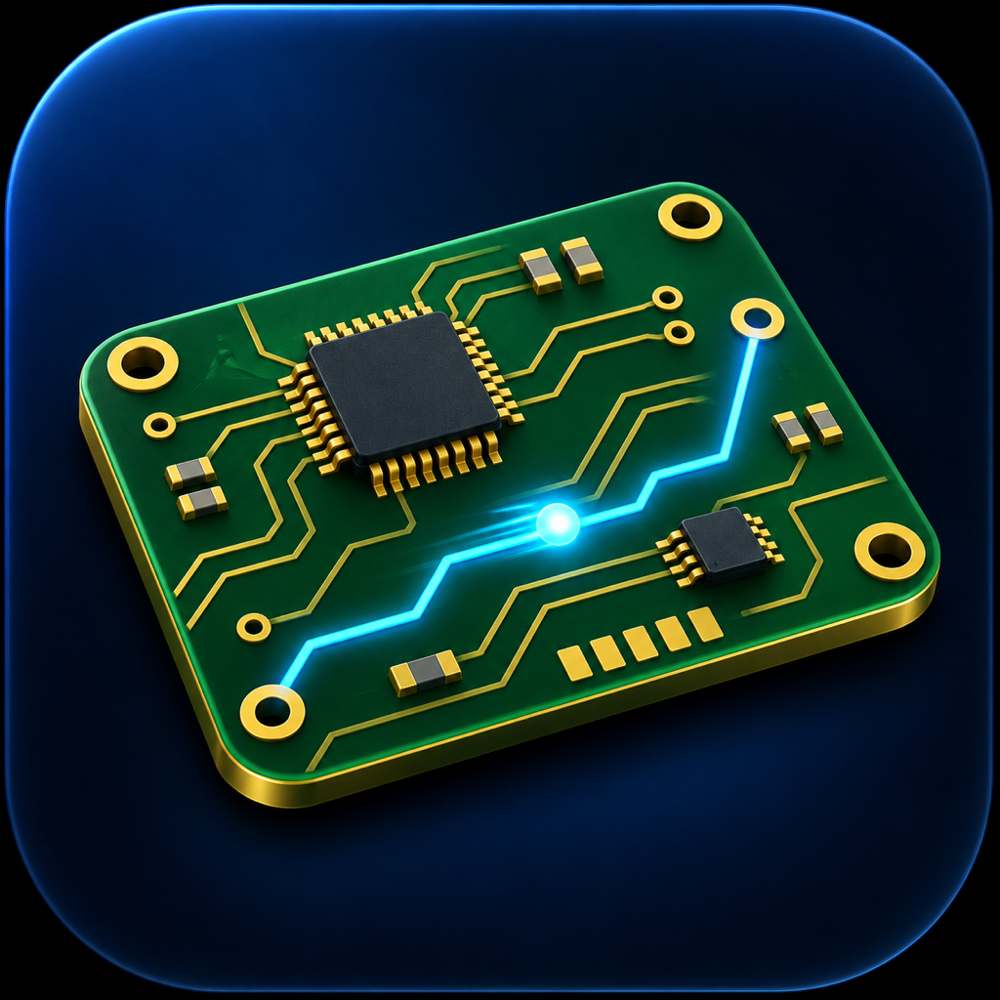

# BoardSim

Open a KiCad board and see what is wrong with it before it is made.



BoardSim reads a `.kicad_pcb` file (KiCad 6 to 10), draws it the way the
finished board looks, and checks every connection:

- **Routing:** nets whose pads are not joined by copper.
- **Part models:** power pins on the wrong rail, 5 V on a 3.3 V pin, a 3.3 V
  output into a 5 V CMOS input, strapping pins that read the wrong level at
  boot, floating inputs, missing pulls, regulator and RC capacitance.
- **Design rules:** decoupling distance, tri-state lines that float on a
  connector, unprotected connector lines, labels that reach one pin.
- **Firmware expectations:** connections listed in `<board>.boardsim.json`
  next to the board, e.g. "GPIO7 reaches the mux input", traced through
  resistors and buffers.

Runs on Windows, macOS and Linux (.NET 8, Avalonia).

## Run

```bash
dotnet run --project src/BoardSim.App -- path/to/board.kicad_pcb
dotnet run --project src/BoardSim.Cli -- check path/to/board.kicad_pcb
```

In the app: drag to pan, scroll to zoom, `F` to fit, click a pad to light up
its net, click a finding to jump to it.

## Expected connections

```jsonc
// board.boardsim.json
{
  "connections": [
    { "from": "U1.GPIO7", "to": "U2.Z", "why": "LED data (RMT)" },
    { "from": "U2.Y0", "to": "J4.2" }
  ]
}
```

Pins are `REF.PIN`, by number or by the name in the part model.

## Part models

A part model is a JSON file describing the pins of one part: type, voltage
range, absolute maximum, input threshold, strapping level, required pulls and
capacitance. Built-in models live in `src/BoardSim.Core/Parts/Models/`. Put
your own `*.part.json` in a `boardsim-parts` folder next to the board.
Parts without a model still get the generic checks.

## Tests

```bash
dotnet test
```

The tests load Julelys v4 (KiCad 10) and v3.1 (KiCad 7) and compare pad
positions and nets with KiCad's own IPC-D-356 export. On v3.1 the rules must
find the faults that v4 fixed; v4 must be clean.
